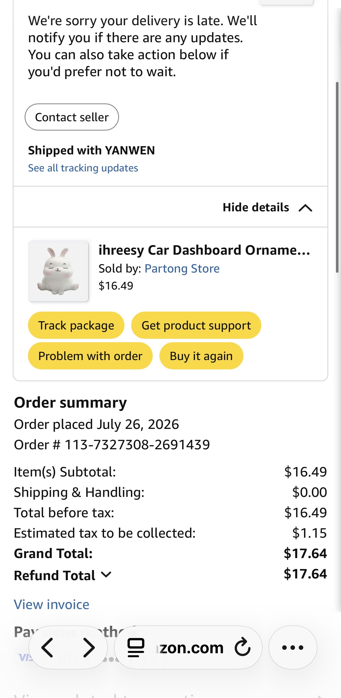

# 🐰 Finding the exact bunny

A research collection dedicated to finding a replacement for a very special bunny figurine. The goal is **this exact sculpt**, not a similar-looking rabbit.

## At a glance

| | Status | What it means |
|---|---|---|
| 🔴 | **No confirmed purchase route** | The latest research pass did not find a reliably purchasable exact match. |
| 🟡 | **Amazon listing exists** | [B0CDZYFMHC](https://www.amazon.com/dp/B0CDZYFMHC) has appeared in stock, but previous orders were refunded or cancelled. A listing is not proof it can be fulfilled. |
| 🟡 | **Supplier leads need checking** | The latest pass describes Yiwu suppliers, but their product photos still need to be compared with the reference. They are **not confirmed matches**. |
| 🔵 | **Other leads are documented** | The research log includes user-identified listings and search terms that may help, but stock, shipping, and fulfillment are not necessarily verified. |

**Research dates:** the corrected status report is dated **1 November 2026**; [Pass 4](bunny-pass-4.html) is dated **2 November 2026**. Availability and prices can change. Later findings and corrections may supersede earlier notes; none of these files is a live inventory tracker.

## 🧭 Where to start

1. **[Latest research: Pass 4](bunny-pass-4.html)** — the most recent dated search, supplier leads, limitations, and suggested next steps.
2. **[Corrected status report](bunny-status-corrected.md)** — the consolidated earlier findings, including corrections and listings to avoid.
3. **[Exact-match shopping card](find-my-bunny.html)** — visual identification and shopping guidance; check Pass 4 for newer updates.
4. **[Manufacturer research](who-makes-your-bunny.html)** — factory and supplier investigation, including outreach guidance. Treat candidates as leads, not confirmed makers.
5. **[Research log](bunny-research-notes.md)** — detailed search history, identifiers, user-provided leads, and rejected lookalikes. Some earlier entries are corrected in later reports.

The HTML reports can be opened directly in a web browser; no installation or build step is needed. Download the repository files together so local images and links remain available.

## 🔎 How to recognize the bunny

Look for all of these features together and compare the actual listing photos with the reference before ordering:

- White, glossy resin figurine, seated with **back legs splayed sideways**.
- **Closed eyes**, pink cheeks and front paws together.
- Reported dimensions: approximately **5 × 5 × 6.5 cm**.
- Amazon variant: **White Rabbit #E**, ASIN `B0CDZYFMHC`, MPN `BQTK37157`.

Identifiers and descriptions are useful search clues, but they do not guarantee that a seller has the right pose or can ship it.

## 🗂️ Files in this repository

| File | Purpose |
|---|---|
| [Original request](I%20am%20autistic%20and%20this%20toy%20bunny%20is%20one%20of%20my%20special%20friends.txt) | Background and previously found listings. |
| [IMG_8979.jpeg](IMG_8979.jpeg), [reference.jpg](reference.jpg) | Reference images for comparing the sculpt. |
| `reference_image`, `bunnycombo` | Additional image assets used in the research collection. |
| [bunny-pass-4.html](bunny-pass-4.html) | Latest dated research pass. |
| [bunny-status-corrected.md](bunny-status-corrected.md) | Earlier consolidated report and corrections. |
| [find-my-bunny.html](find-my-bunny.html) | Exact-match shopping card. |
| [who-makes-your-bunny.html](who-makes-your-bunny.html) | Supplier and manufacturer research. |
| [bunny-research-notes.md](bunny-research-notes.md) | Running research log. |

## 🛡️ Before contacting a seller or buying

- **Confirm the exact pose** in current photos, not just the title or product family.
- Ask whether the item is actually available and whether it can ship to your location.
- Treat displayed stock counts and unverified suppliers as leads, not guarantees.
- Avoid entering personal or payment information on unencrypted or untrusted sites.
